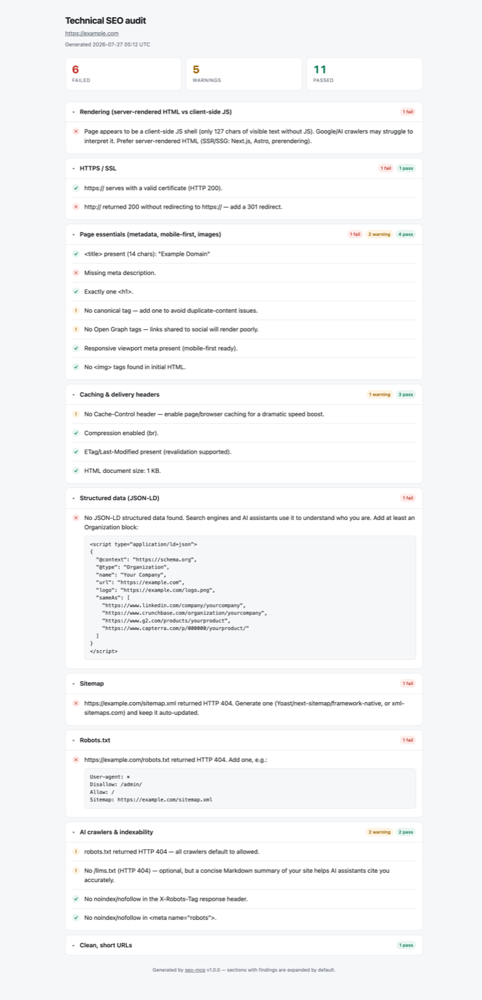

# technical-seo-mcp

**An MCP server that audits websites for technical and on-page SEO — so you can ask your AI assistant "why isn't this page ranking?" and get a specific, actionable answer.**

<!-- The CI and npm badges resolve once the repo is pushed and the package is
     published; they render as "unknown" until then. -->

[](https://github.com/sourav2024/seo-mcp/actions/workflows/ci.yml)
[](https://www.npmjs.com/package/technical-seo-mcp)
[](https://nodejs.org)
[](LICENSE)
[](https://github.com/sponsors/sourav2024)

14 tools covering crawlability, HTTPS, Core Web Vitals, sitemaps, `robots.txt`,
structured data, international SEO (hreflang), keyword placement, and AI-crawler access. Reports come back as
Markdown, JSON for CI, or a standalone HTML file you can open and send to a client.

No API keys. No accounts. Every check runs directly against the live site.

---

## Table of contents

- [Why this exists](#why-this-exists)
- [Features](#features)
- [Screenshots](#screenshots)
- [Prerequisites](#prerequisites)
- [Quick start](#quick-start)
- [Supported MCP clients](#supported-mcp-clients)
- [Tools](#tools)
- [Usage examples](#usage-examples)
- [Output formats](#output-formats)
- [Configuration](#configuration)
- [Architecture](#architecture)
- [Troubleshooting & FAQ](#troubleshooting--faq)
- [Roadmap](#roadmap)
- [Contributing](#contributing)
- [Support this project](#support-this-project)
- [Security](#security)
- [License](#license)
- [Acknowledgements](#acknowledgements)

---

## Why this exists

SEO tools tend to give you a dashboard. What you usually want is an answer.

Because this runs as an MCP server, your assistant can chain a diagnosis:
audit the page, notice the `h1` is missing, read the actual template file,
and propose the fix — in one conversation. The report is designed for that:
every finding says what is wrong _and_ how to fix it, with paste-ready snippets
where they help.

It is also deliberately small: two runtime dependencies, no database, no
telemetry, no signup.

## Features

- **14 focused tools** — one full audit, one site crawl, and twelve individual
  checks you can run in isolation
- **AI-crawler visibility** — per-bot `robots.txt` status for GPTBot, ClaudeBot,
  Google-Extended, PerplexityBot, and CCBot, plus `llms.txt` and `noindex`
  detection in _both_ the `X-Robots-Tag` header and the meta tag
- **Site-wide aggregation** — `crawl_audit` reports "this problem is on 80% of
  your pages, fix it once in the template" instead of repeating it per page
- **Three output formats** — Markdown inline, JSON for CI pipelines, or a
  shareable HTML file
- **Regression tracking** — `compare_to_baseline` diffs against your last run and
  reports new failures, new warnings, and fixed items
- **Actionable findings** — severity-rated ✅/⚠️/❌, each with the concrete fix
- **Fast** — every URL is fetched exactly once per audit and shared across checks
- **Safe by construction** — see [Security](#security)

## Screenshots

**HTML report** (`output: "html"`) — a standalone file you can open, print, or
send to a client. Sections with findings expand by default; all-clear sections
stay collapsed. All CSS is inlined and nothing is fetched, so it works offline.



## Prerequisites

| Requirement       | Version    | Notes                                                               |
| ----------------- | ---------- | ------------------------------------------------------------------- |
| **Node.js**       | ≥ 20.10    | Uses built-in `fetch` and `node:test`. Check with `node --version`. |
| **An MCP client** | any        | See [supported clients](#supported-mcp-clients).                    |
| **Google Chrome** | any recent | **Only** for `run_lighthouse`. The other 13 tools need nothing.     |

Chrome is auto-detected on macOS, Linux, and Windows. Set `CHROME_PATH` if yours
lives somewhere unusual. Lighthouse itself is fetched on demand via `npx` on
first use — no install step, but the first run is slower.

## Quick start

### Claude Code

```bash
claude mcp add technical-seo -- npx -y technical-seo-mcp
```

Then ask: _"Run a full technical SEO audit on example.com"_

> **Three similar names, one project** — worth knowing before you edit any config:
>
> | Name                | What it is                                                           |
> | ------------------- | -------------------------------------------------------------------- |
> | `technical-seo-mcp` | the **npm package** — what you install                               |
> | `seo-mcp`           | the **command** it installs (`technical-seo-mcp` also works)         |
> | `technical-seo`     | the **server name** your client shows; you choose this in the config |
>
> Only the package name is fixed. Name the server whatever you like — `seo`,
> `audit`, anything — by changing the label in your client config.

### Claude Desktop

Add to `claude_desktop_config.json`:

```json
{
  "mcpServers": {
    "technical-seo": {
      "command": "npx",
      "args": ["-y", "technical-seo-mcp"]
    }
  }
}
```

Config file locations:

- **macOS** — `~/Library/Application Support/Claude/claude_desktop_config.json`
- **Windows** — `%APPDATA%\Claude\claude_desktop_config.json`
- **Linux** — `~/.config/Claude/claude_desktop_config.json`

Restart Claude Desktop after editing.

### Cursor / Windsurf / other clients

Any client that speaks MCP over stdio works with the same command:

```json
{
  "mcpServers": {
    "technical-seo": {
      "command": "npx",
      "args": ["-y", "technical-seo-mcp"]
    }
  }
}
```

### Global install

If you prefer a pinned binary over `npx` resolution:

```bash
npm install -g technical-seo-mcp
seo-mcp --version
```

Then use `"command": "seo-mcp"` with no `args` in your client config.

### From source

```bash
git clone https://github.com/sourav2024/seo-mcp
cd seo-mcp
npm install
npm run verify        # lint + tests + MCP protocol smoke test

claude mcp add technical-seo -- node "$PWD/server.js"
```

### Verify the setup

Two things are worth checking separately, because they fail for different reasons.

**1. Does the server itself run?** This rules out Node version and install problems:

```bash
npx -y technical-seo-mcp --version   # prints e.g. 1.0.0
```

**2. Did your client actually connect?** A server that runs fine can still fail to
register — usually a typo in the config JSON or a config file that wasn't reloaded.

- **Claude Code** — run `/mcp`. You should see `technical-seo` listed as connected.
- **Claude Desktop** — the tools appear under the 🔨 icon in the message box.
  Restart the app after editing the config; it does not reload on its own.
- **Any client** — ask _"What technical SEO tools do you have?"_ The assistant
  should list `seo_full_audit`, `crawl_audit`, and the twelve `check_*` tools.

**3. Run your first audit.** This confirms the whole path works end to end:

> _"Run a full technical SEO audit on example.com"_

You should get a report with ✅/⚠️/❌ per check. If any step fails, see
[Troubleshooting](docs/troubleshooting.md).

There is no build step — the project is plain ESM and runs directly on Node 20+.

## Supported MCP clients

| Client               | Status     | Notes                                                      |
| -------------------- | ---------- | ---------------------------------------------------------- |
| **Claude Code**      | ✅ Tested  | `claude mcp add technical-seo -- npx -y technical-seo-mcp` |
| **Claude Desktop**   | ✅ Tested  | Via `claude_desktop_config.json`                           |
| **Cursor**           | — Untested | Standard stdio MCP config                                  |
| **Windsurf**         | — Untested | Standard stdio MCP config                                  |
| **Zed**              | — Untested | Standard stdio MCP config                                  |
| **Continue.dev**     | — Untested | Standard stdio MCP config                                  |
| **Custom (MCP SDK)** | ✅         | Anything speaking MCP over stdio                           |

"Untested" means the server follows the stdio MCP spec and should work, but no
maintainer has verified it. If you use one of these, a confirmation (or a
bug report) is welcome.

### Protocol support

- stdio transport (no HTTP — see [Security](#security))
- Tools annotated `readOnlyHint`, since audits never mutate the target site
- Tool failures return `isError: true` results rather than protocol errors, so
  the model can read and react to them
- **Progress notifications** for long operations: pass a `progressToken` and
  `crawl_audit`, `seo_full_audit`, and `run_lighthouse` report as they go
- **Cancellation**: cancelling a request stops the crawl between pages and
  terminates a running Lighthouse process
- **`structuredContent`** on `output: "json"`, so a client can consume the result
  object without re-parsing a string

## Tools

### Site-level audits

| Tool             | Checks                                                                                                                                                                                                                                                                                                                                                                                                                               |
| ---------------- | ------------------------------------------------------------------------------------------------------------------------------------------------------------------------------------------------------------------------------------------------------------------------------------------------------------------------------------------------------------------------------------------------------------------------------------ |
| `seo_full_audit` | Everything below on one URL, in one report with ✅/⚠️/❌ per item (except Lighthouse). Supports `output: "json"`/`"html"` and `compare_to_baseline`                                                                                                                                                                                                                                                                                  |
| `crawl_audit`    | Crawls up to `max_pages` (default 25) seeded from `sitemap.xml` (sitemap-index aware; falls back to internal links), fetching each page once with a polite delay. Aggregates **site-wide issues** (>50% of pages — fix once in the template), **broken internal links**, **multi-hop redirect chains**, **duplicate titles/descriptions**, and **orphan sitemap URLs**. Supports `output: "json"`/`"html"` and `compare_to_baseline` |

### Technical SEO

| Tool                    | Checks                                                                                                                                                                                                                                                                                                                                                                                                                                                                                                                    |
| ----------------------- | ------------------------------------------------------------------------------------------------------------------------------------------------------------------------------------------------------------------------------------------------------------------------------------------------------------------------------------------------------------------------------------------------------------------------------------------------------------------------------------------------------------------------- |
| `check_rendering`       | Fetches the page **without JavaScript** and detects client-side JS shells that Google/AI crawlers struggle to read — recommends SSR/SSG when needed                                                                                                                                                                                                                                                                                                                                                                       |
| `check_https`           | Valid SSL certificate on `https://`, and a permanent **301** redirect from `http://` (flags temporary 302/307)                                                                                                                                                                                                                                                                                                                                                                                                            |
| `check_url_structure`   | Clean-URL rules: ≤ ~60 chars, lowercase, hyphens not underscores, no accents, no messy query params, shallow hierarchy. **Offline** — makes no requests                                                                                                                                                                                                                                                                                                                                                                   |
| `check_page_essentials` | `<title>` presence and length, meta description, exactly one `<h1>`, canonical tag, Open Graph tags, responsive viewport meta, image lazy-loading, WebP/AVIF usage, and explicit image `width`/`height` (CLS risk — no Lighthouse run needed)                                                                                                                                                                                                                                                                             |
| `check_caching`         | `Cache-Control`, compression (gzip/brotli), `ETag`/`Last-Modified` revalidation, HTML document size                                                                                                                                                                                                                                                                                                                                                                                                                       |
| `check_sitemap`         | `/sitemap.xml` exists, entry count, admin/cart/checkout URLs that should be excluded, **samples up to 10 `<loc>` URLs** to verify they return 200 with no redirects, and flags missing or stale `lastmod`                                                                                                                                                                                                                                                                                                                 |
| `check_robots`          | `/robots.txt` exists **and is valid** (catches HTML pages or redirects served at that path), references the sitemap, and doesn't accidentally block the whole site                                                                                                                                                                                                                                                                                                                                                        |
| `check_hreflang`        | **International SEO.** Validates BCP-47 hreflang values (catching `en_US`, `en-UK`, `en-EU`), requires a self-referencing annotation, checks for `x-default`, flags duplicate/conflicting values and relative hrefs, and confirms `<html lang>` agrees. With `verify_return_links: true` it fetches each alternate and verifies reciprocity — **missing return links are the most common reason Google ignores an otherwise-correct cluster**. A single-language site is told hreflang isn't needed, not that it's broken |
| `check_structured_data` | Extracts schema.org **JSON-LD** (tolerates arrays and `@graph`): Organization (incl. `sameAs`), SoftwareApplication, FAQPage (Question/acceptedAnswer structure), BreadcrumbList. Malformed blocks are flagged with the parse error; no JSON-LD gets a ready-to-paste Organization example                                                                                                                                                                                                                                |
| `check_ai_crawlers`     | Effective allow/block status per bot — **GPTBot, ClaudeBot, Google-Extended, PerplexityBot, CCBot** — and the `*` default. Checks `/llms.txt`, and flags `noindex`/`nofollow` in **both** the `X-Robots-Tag` header and `<meta name="robots">`, which a plain `robots.txt` check cannot see                                                                                                                                                                                                                               |
| `run_lighthouse`        | Lighthouse performance + SEO scores and **Core Web Vitals**: LCP (≤ 2.5 s), CLS (≤ 0.1), INP (≤ 200 ms — falls back to TBT when a lab run can't simulate interactions), plus top speed opportunities. Mobile by default. Slow (~1–2 min); requires Chrome                                                                                                                                                                                                                                                                 |

### On-page SEO

| Tool                      | Checks                                                                                                                                                                                                                                                                                                            |
| ------------------------- | ----------------------------------------------------------------------------------------------------------------------------------------------------------------------------------------------------------------------------------------------------------------------------------------------------------------- |
| `check_keyword_placement` | Where target keywords appear: `<title>` (and whether front-loaded), URL path, meta description, `<h1>`, `<h2>`s, first ~100 words, image alt text, and keyword density — flagging both thin usage (< 0.3%) and stuffing (> 3%). Matching is **plural/stem-tolerant** ("freight broker" matches "freight brokers") |

### Not covered, by design

- **Keyword research** — search volume and difficulty need external paid data
  (Ahrefs, Semrush, Google Keyword Planner)
- **Backlinks / off-page SEO** — requires a crawled link index
- **Rendered-page visual checks** — pair with
  [Playwright MCP](https://github.com/microsoft/playwright-mcp) for screenshots
  and JS-rendered inspection

## Usage examples

Ask in plain language; the client picks the tool.

| You say                                                                | Tool used                                         |
| ---------------------------------------------------------------------- | ------------------------------------------------- |
| "Run a full technical SEO audit on example.com"                        | `seo_full_audit`                                  |
| "Crawl example.com and find site-wide SEO issues"                      | `crawl_audit`                                     |
| "Audit example.com and give me an HTML report I can send to a client"  | `seo_full_audit` with `output: "html"`            |
| "Can GPTBot and ClaudeBot crawl my site?"                              | `check_ai_crawlers`                               |
| "Is my LCP under 2.5 seconds on mobile?"                               | `run_lighthouse`                                  |
| "Check keyword placement for 'freight broker software' on example.com" | `check_keyword_placement`                         |
| "Validate my JSON-LD"                                                  | `check_structured_data`                           |
| "I target the US and Canada — is my hreflang set up right?"            | `check_hreflang`                                  |
| "Do my hreflang alternates all link back to each other?"               | `check_hreflang` with `verify_return_links: true` |
| "Re-audit and tell me what changed since last time"                    | `seo_full_audit` with `compare_to_baseline: true` |
| "Why isn't this page indexed?"                                         | `check_ai_crawlers` + `check_robots`              |

### A useful pattern: audit, then fix

Because the assistant has both the audit _and_ your codebase, you can go
straight from finding to patch:

> "Audit localhost:3000, then fix everything you found in the Next.js layout."

### CI integration

`output: "json"` gives you machine-readable results:

```json
{
  "target": "https://example.com",
  "generated_at": "2026-07-27T10:00:00.000Z",
  "counts": { "pass": 18, "warn": 4, "fail": 2 },
  "sections": [{ "section": "Page essentials", "checks": [{ "severity": "fail", "text": "..." }] }]
}
```

Fail a build when `counts.fail > 0`, or use `compare_to_baseline` to fail only on
_new_ regressions:

```bash
SEO_MCP_STATE_DIR=./.seo-baselines   # commit these to track over time
```

## Output formats

`seo_full_audit` and `crawl_audit` accept:

- **`output: "markdown"`** (default) — the report inline, ✅/⚠️/❌ per check.
- **`output: "json"`** — structured per-check severity plus `{pass, warn, fail}`
  counts, ready for CI or a dashboard.
- **`output: "html"`** — writes a **standalone HTML file** and returns its path
  plus a one-line summary. The markup never goes through the MCP transport, so it
  costs no context. Sections with findings expand, all-clear sections collapse,
  and fix snippets render as copyable code blocks. All CSS is inlined and nothing
  is fetched, so it works offline, over `file://`, and as an email attachment.
  Light/dark aware and print-friendly.
  - **`output_path`** — a destination file or directory. Defaults to
    `./seo-report-<host>-<date>.html` (`seo-crawl-…` for crawls).
- **`compare_to_baseline: true`** — prepends a diff: **new failures**, **new
  warnings**, and **fixed items** since the last run. The first run saves a baseline.

Baselines are stored **per target**, one file each, under your OS state directory
(`~/Library/Application Support/seo-mcp` on macOS, `$XDG_STATE_HOME/seo-mcp` or
`~/.local/state/seo-mcp` on Linux, `%LOCALAPPDATA%\seo-mcp` on Windows) — never
inside the package, which is read-only under `npx`. Override with
`SEO_MCP_STATE_DIR`.

## Configuration

Every setting is an **optional** environment variable with a safe default.
Invalid values fall back to the default and log a warning rather than crashing.
See [`.env.example`](.env.example) for the fully commented list.

This server does not read `.env` files — MCP servers are launched by a client, so
set variables in the client config:

```json
{
  "mcpServers": {
    "technical-seo": {
      "command": "npx",
      "args": ["-y", "technical-seo-mcp"],
      "env": {
        "SEO_MCP_LOG_LEVEL": "debug",
        "SEO_MCP_CRAWL_DELAY_MS": "1000"
      }
    }
  }
}
```

| Variable                        | Default    | Purpose                                                                  |
| ------------------------------- | ---------- | ------------------------------------------------------------------------ |
| `SEO_MCP_LOG_LEVEL`             | `info`     | `silent` \| `error` \| `warn` \| `info` \| `debug`                       |
| `SEO_MCP_LOG_FORMAT`            | `json`     | `json` (one object per line) or `text` (human-readable)                  |
| `SEO_MCP_FETCH_TIMEOUT_MS`      | `20000`    | Per-request timeout (1000–120000)                                        |
| `SEO_MCP_PROBE_TIMEOUT_MS`      | `15000`    | Timeout for HTTPS/redirect probes                                        |
| `SEO_MCP_MAX_BODY_BYTES`        | `10485760` | Cap on bytes read per response (64 KB–256 MB)                            |
| `SEO_MCP_MAX_REDIRECT_HOPS`     | `5`        | Redirect hops before giving up (1–20)                                    |
| `SEO_MCP_CRAWL_DELAY_MS`        | `500`      | Politeness delay between crawled pages (0–60000)                         |
| `SEO_MCP_CRAWL_MAX_PAGES`       | `100`      | Hard ceiling on `max_pages` (1–1000)                                     |
| `SEO_MCP_CRAWL_CONCURRENCY`     | `1`        | Parallel page fetches during a crawl (1–8). Raise only for sites you own |
| `SEO_MCP_LIGHTHOUSE_TIMEOUT_MS` | `180000`   | Lighthouse run timeout (30000–600000)                                    |
| `SEO_MCP_STATE_DIR`             | OS default | Where baselines are stored                                               |
| `SEO_MCP_ALLOW_PRIVATE_HOSTS`   | `true`     | Allow auditing localhost / private IPs — see [Security](#security)       |
| `CHROME_PATH`                   | auto       | Chrome binary for Lighthouse                                             |

**There are no secrets or API keys.** Nothing is ever logged that could carry a
credential: URL userinfo and credential-bearing query parameters are stripped
from log output, and sensitive field names are redacted.

## Architecture

```text
server.js              MCP tool registration only — no audit logic
src/
  config.js            All tunables; validated env vars with safe defaults
  logger.js            Structured stderr logging with redaction
  url-guard.js         URL validation and SSRF / private-host checks
  tool-result.js       MCP result shapes and error-message mapping
  version.js           Version and identity constants
checks/
  index.js             Registry — re-exports every check
  helpers.js           Shared fetch, redirect walking, stemming, report parsing
  rendering.js         JS-shell detection
  https.js             SSL + http→https redirect classification
  urls.js              Clean-URL rules
  page-essentials.js   Title/meta/h1/canonical/OG/viewport/images
  caching.js           Cache-Control, compression, ETag, size
  sitemap.js           Sitemap validation, URL sampling, collection
  robots.js            robots.txt validation
  keywords.js          Keyword placement + density
  structured-data.js   JSON-LD / schema.org validation
  ai-crawlers.js       Per-bot robots status, llms.txt, noindex detection
  lighthouse.js        Core Web Vitals via npx lighthouse + Chrome detection
  crawl.js             Multi-page crawl + aggregation
  report.js            markdown/JSON/HTML output + baseline diffing
  html-report.js       Standalone HTML renderer (inlined CSS, no subresources)
test/                  node:test suites (fixtures, output, guards, logging, config)
scripts/smoke.js       End-to-end MCP wire-protocol check
```

Three design decisions worth knowing:

1. **`server.js` holds no audit logic; `checks/` never touches MCP.** That
   boundary is what makes every check directly unit-testable without a client.
2. **Every URL is fetched exactly once per audit.** Checks accept an optional
   prefetched `page` and a shared resource cache, so a full audit makes **5
   requests** — the page, `robots.txt`, `sitemap.xml`, `llms.txt`, and one
   `http://` redirect probe — instead of re-requesting the page for each of the
   five checks that need it.
3. **Failures are contained.** `Promise.allSettled` means an unreachable sitemap
   degrades to one ❌ line instead of losing the whole report, and every tool
   handler is wrapped so nothing can escape into the transport.
4. **Crawl workers share one queue.** Raising `SEO_MCP_CRAWL_CONCURRENCY` adds
   workers that pull from the same queue, so link discovery still reaches pages
   found by other workers and no URL is fetched twice.

## Troubleshooting & FAQ

Common problems — connection failures, missing Chrome, timeouts, permission
errors — and answers to recurring questions are in
**[docs/troubleshooting.md](docs/troubleshooting.md)**.

The fastest first step for almost any issue is debug logging:

```json
{ "env": { "SEO_MCP_LOG_LEVEL": "debug", "SEO_MCP_LOG_FORMAT": "text" } }
```

All logs go to stderr — stdout carries the MCP protocol.

## Roadmap

Not commitments — ideas, roughly in priority order.
[Feedback welcome](https://github.com/sourav2024/seo-mcp/discussions).

### Next

- `check_images` — deeper image audit (dimensions, formats, `srcset`, alt quality)
- Core Web Vitals from real field data (CrUX API) alongside lab numbers
- Internal-link graph analysis: orphan pages, click depth, anchor-text distribution

### Later

- DNS-rebinding protection (resolve and pin the address before connecting)
- Configurable crawl concurrency with per-host rate limiting
- MCP resources for browsing saved baselines
- MCP prompts for common workflows ("pre-launch checklist", "fix my Core Web Vitals")
- Optional JS rendering behind a flag, for SPA-heavy sites

### Under consideration

- A GitHub Action wrapping the JSON output for PR comments
- Competitor comparison (audit N URLs side by side)

## Contributing

Contributions are welcome — especially new checks and false-positive fixes.
Start with [CONTRIBUTING.md](CONTRIBUTING.md), which covers the layout, how to
add a check, and what makes a good one.

```bash
git clone https://github.com/sourav2024/seo-mcp
cd seo-mcp
npm install
npm run verify     # lint + tests + MCP smoke test
```

- [Report a bug](https://github.com/sourav2024/seo-mcp/issues/new?template=bug_report.yml)
- [Request a feature](https://github.com/sourav2024/seo-mcp/issues/new?template=feature_request.yml)
- [Ask a question](https://github.com/sourav2024/seo-mcp/discussions)
- [Get help](SUPPORT.md)

By participating you agree to the [Code of Conduct](CODE_OF_CONDUCT.md).

## Security

This server is designed to run **locally over stdio**, where the URLs it fetches
come from you. It defends against hostile _content_ from audited sites: URL
scheme validation, per-hop redirect re-validation, HTML escaping in reports,
prototype-pollution-safe parsing, body-size caps, and no-shell subprocess
spawning.

Two things to know:

- **Auditing private hosts works by default** (`localhost`, `10.x`, `192.168.x`).
  That's intentional and useful locally.
- **If you expose this to input you don't control, set
  `SEO_MCP_ALLOW_PRIVATE_HOSTS=false`.** That enables SSRF protection, blocking
  private, loopback, and link-local targets — including the
  `169.254.169.254` cloud-metadata address — and re-checking every redirect hop.

Full threat model, known limitations, and a hardening checklist:
[SECURITY.md](SECURITY.md).

**Found a vulnerability?** Report it
[privately](https://github.com/sourav2024/seo-mcp/security/advisories/new) —
please don't open a public issue.

## Support this project

This is free and MIT-licensed, and it stays that way. If it saved you an
afternoon of SEO debugging, you can
[sponsor the work on GitHub](https://github.com/sponsors/sourav2024).

Things that help just as much and cost nothing: starring the repo, filing a good
bug report, or telling me which check produced a false positive on your site.

## License

[MIT](LICENSE) © sourav2024

## Acknowledgements

- [Model Context Protocol](https://modelcontextprotocol.io) and the
  [TypeScript SDK](https://github.com/modelcontextprotocol/typescript-sdk),
  by Anthropic
- [Google Lighthouse](https://github.com/GoogleChrome/lighthouse) for Core Web
  Vitals measurement
- [Zod](https://zod.dev) for input schema validation
- Google's [Search Central documentation](https://developers.google.com/search/docs)
  and the [schema.org](https://schema.org) vocabulary, which define what most of
  these checks are checking against
