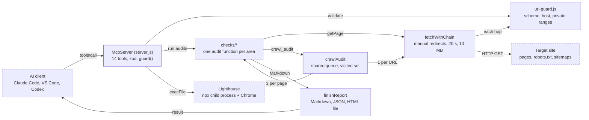

# Technical SEO MCP: design notes

A Model Context Protocol server. An AI client launches it as a subprocess and calls tools that fetch a live site and return pass, warn and fail lines.

## In short

AI assistants can talk about SEO but cannot check a live site. This server gives them 14 deterministic tools: rendering, HTTPS, sitemap, robots, structured data, hreflang, caching, AI-crawler access, a multi-page crawl and Lighthouse. The client starts it with `npx` and speaks JSON-RPC over stdin and stdout. Each tool validates its input with zod, fetches each URL once, and returns Markdown, JSON or an HTML report. It has two runtime dependencies and no API keys.

## Architecture

The AI client talks to the server over stdio. Checks share one fetcher, which re-validates every redirect hop. The crawler feeds pages it discovers back into its own queue.

## How a `seo_full_audit` call runs

1. The client sends `tools/call`. The SDK validates arguments against the tool's zod schema.
2. `assertFetchableUrl(url)` normalises the URL and rejects non-http(s) schemes.
3. `getPage(target)` fetches the page once; `newResourceCache()` makes a per-audit map so `robots.txt` is also fetched once.
4. Nine checks run under `Promise.allSettled`: rendering, HTTPS, page essentials, caching, structured data, hreflang, sitemap, robots and AI crawlers.
5. A check that rejects becomes a single failed section through `describeError`; the others still report.
6. `finishReport` parses the Markdown, optionally diffs it against a saved baseline, and returns Markdown, JSON with `structuredContent`, or a path to a self-contained HTML file.
7. For `crawl_audit`: resolve the start URL, seed the queue from sitemaps, then workers fetch each page once and run three audits on it. Post-passes find broken links, redirect chains, duplicate titles and orphans.

## Libraries

| Library                             | Used for                                                                                        |
| ----------------------------------- | ----------------------------------------------------------------------------------------------- |
| `@modelcontextprotocol/sdk`         | `McpServer` and `StdioServerTransport`. It handles `initialize`, `tools/list` and `tools/call`. |
| `zod`                               | Input schemas for every tool.                                                                   |
| `global fetch, AbortSignal.timeout` | All HTTP, with a 20 s limit per request.                                                        |
| `node:dns`                          | Resolving hostnames so the SSRF guard can check every address.                                  |
| `node:child_process`                | Running `npx lighthouse@<pinned>` with `shell: false` and a 180 s timeout.                      |
| `node:test`                         | Tests, using real local HTTP servers as fixtures.                                               |

## Design decisions and trade-offs

### Thin server, logic in checks

`server.js` only registers tools and handles lifecycle. Each area is one `audit*` function that returns Markdown.

**Trade-off:** Markdown is the internal format, so JSON and HTML are produced by re-parsing emoji-prefixed lines.

### Fetch once, share everywhere

`getPage` accepts a prefetched page and `getResource` caches the promise, including failures.

**Trade-off:** Fewer requests to the target. A transient failure is cached for the rest of that audit.

### SSRF guard that re-checks every redirect

Redirects are followed manually. With the guard on, each hop passes `assertRedirectTarget` and every resolved DNS address is checked against private, loopback and link-local ranges.

**Trade-off:** It is opt-in, because auditing `localhost` is a core use. A DNS-rebinding window remains.

### A polite crawler

Concurrency defaults to 1 (max 8), with a 500 ms delay before every fetch, a 25-page default and 100-page cap.

**Trade-off:** Slow by default. There is no per-host token bucket, so raising concurrency raises the request rate.

### Sitemap first, links second

Seeds come from `robots.txt` `Sitemap:` lines, then common sitemap paths, following an index one level. With no sitemap it falls back to breadth-first link discovery.

**Trade-off:** In sitemap mode, links found on pages are not added to the queue.

### Errors come back as tool results

`guard()` wraps every handler and returns `isError: true` with a message mapped from the Node error code.

**Trade-off:** The model can react to a failure. Protocol errors are left to the SDK.

### No HTML parser

Titles, meta tags, links and sitemap entries are extracted with regular expressions.

**Trade-off:** Zero parsing dependencies and fast start under `npx`. Fragile with unusual markup.

### Progress and cancellation

Progress notifications are sent only when the request carried a progress token. The abort signal is checked between pages.

**Trade-off:** An in-flight fetch still runs to completion or timeout.

## What MCP is, in two sentences

- Model Context Protocol is a JSON-RPC 2.0 protocol that lets an AI client discover and call capabilities on a server.
- Here the client spawns the server and exchanges newline-delimited JSON on stdin and stdout, so all logging must go to stderr.
- This server exposes tools only. It registers no resources or prompts.

## The 14 tools

- `seo_full_audit`, `crawl_audit`, `run_lighthouse`.
- `check_rendering` (server-rendered vs JS shell), `check_https`, `check_page_essentials`, `check_caching`.
- `check_sitemap`, `check_robots`, `check_structured_data`, `check_hreflang`.
- `check_url_structure`, `check_keyword_placement`, `check_ai_crawlers` (GPTBot, ClaudeBot, Google-Extended, PerplexityBot, CCBot).

## What the SSRF guard blocks when enabled

- IPv4: `0/8`, `10/8`, `100.64/10`, `127/8`, `169.254/16`, `172.16/12`, `192.168/16`, `198.18/15`, multicast and reserved.
- IPv6: `::`, `::1`, `fc00::/7`, `fe80::/10` and IPv4-mapped forms.
- Names: `localhost`, `*.local`, `*.internal`, `*.home.arpa`, and hostnames without a dot.

## Numbers

- **Tools:** 14
- **Tests:** 150 passing, in 10 files
- **Runtime dependencies:** 2
- **Source:** about 3,650 lines
- **CI:** Linux on Node 20.10, 22, 24, plus macOS
- **Limits:** 20 s per request, 5 redirects, 10 MB body

## Design FAQ

### What is MCP?

A JSON-RPC protocol that lets an AI client discover and call tools on a server. This server registers 14 tools on `McpServer` and connects over `StdioServerTransport`; the client launches it as a subprocess.

### Why does a local tool need SSRF protection?

The URL comes from a model, which may be acting on untrusted page content, and the server follows redirects. A public URL can redirect to `169.254.169.254` or `127.0.0.1`. When the guard is on, every hop and every resolved address is checked.

### How do you avoid hammering a site?

Concurrency 1 by default, a 500 ms delay before every fetch, a page cap, each URL fetched once and shared across checks, and a user agent that identifies the tool.

### How would you scale the crawler?

Today it is in memory in one process. I would add a per-host rate limiter, honour `robots.txt` Disallow and Crawl-delay, persist the frontier, stream results, and move to a streamable transport for long jobs.

### How do you test network code?

Real `node:http` servers on localhost with deliberate defects, counting requests to prove each URL is fetched once. DNS is faked by injecting a lookup function. A smoke script drives the real server over stdio.

### Why regular expressions and not an HTML parser?

No parsing dependency and fast start under `npx`. The cost is fragility with unquoted attributes, attribute order, and markup inside comments or scripts.

### How are errors surfaced to the model?

A failed tool returns `isError: true` with an actionable message. One failing check inside a full audit becomes a single failed section, not a failed call.

### Why is there no output schema?

The SDK enforces a declared schema on every result, and the Markdown and HTML modes return no structured content. JSON mode still returns `structuredContent`.

## Known limitations

- The SSRF guard is off by default.
- Default crawl concurrency is 1. It is concurrent only when configured, up to 8.
- The crawler does not obey `robots.txt` Disallow or Crawl-delay for its own fetching.
- It does not render JavaScript itself. Only the Lighthouse tool runs a browser.
- Regex-based HTML and XML parsing.
- Cancellation is checked between pages, not during a fetch.
- Severity is carried by emoji prefixes and re-parsed, so different issues can collide on one key.
- The sitemap index is followed one level with ten children; the 500-URL cap is silent.
- stdio only: one process per client and no caching across calls.

---

Written from the source code as it stood on 26 November 2026.
